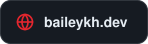
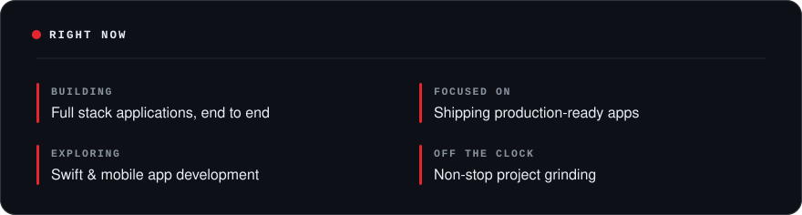

  

  

  
  &nbsp;
  

 

## About Me

I enjoy building software that balances thoughtful design with solid engineering. Most of my experience is in the **React** and **TypeScript** ecosystem, but I've become increasingly drawn to backend development, application architecture, authentication, databases, and the systems that make great user experiences possible.

I love building projects from the ground up and understanding how everything fits together, from responsive interfaces to APIs and infrastructure. Whatever I'm working on, the goal stays the same: **build software that's clean, reliable, and enjoyable to use.**

  

 

## Tech Stack

  

 

### BootDev Stats (always stay learning)

  

